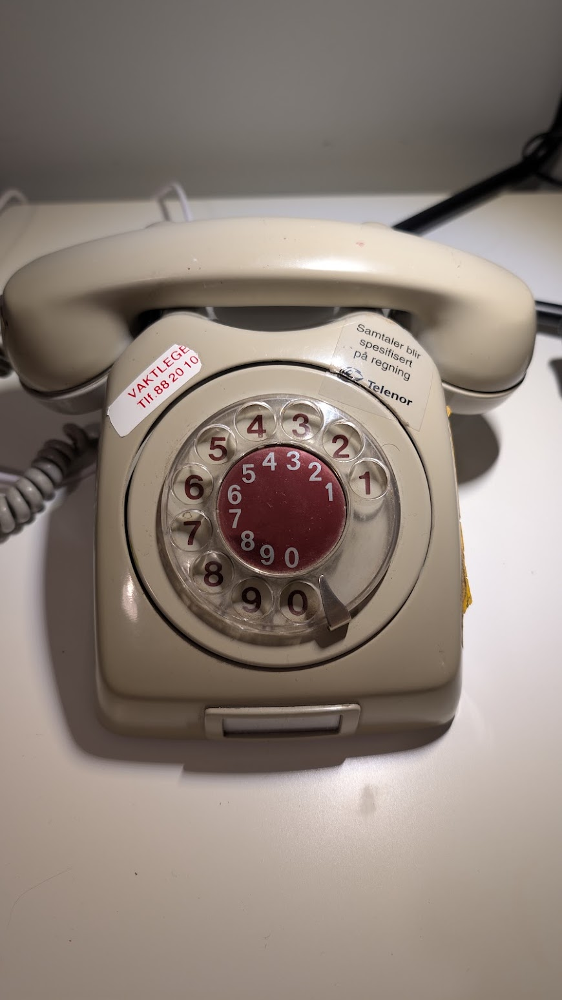
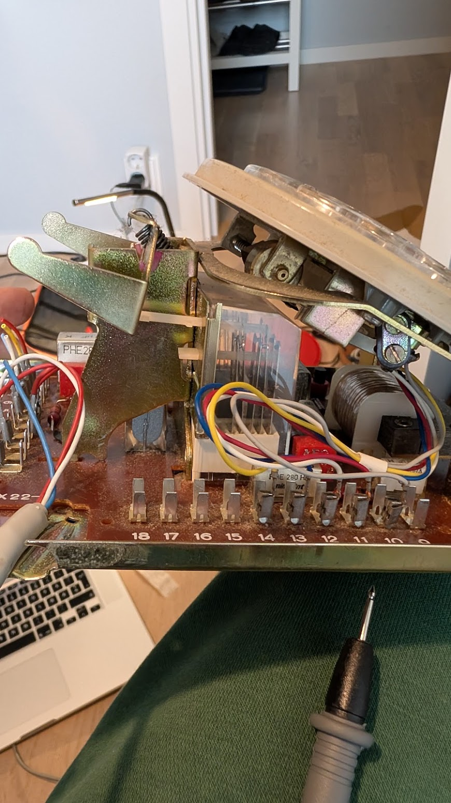
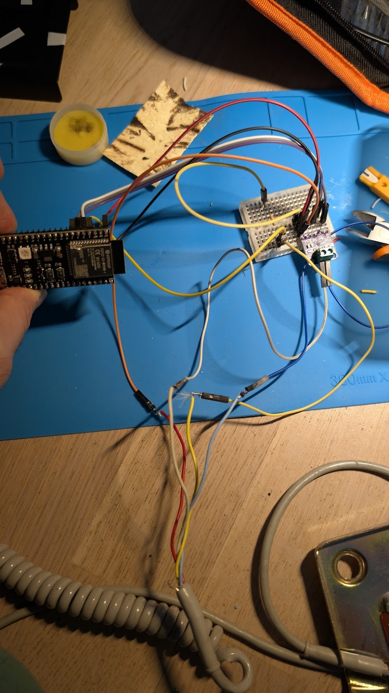

# Retro AI Rotary Phone Assistant

Turn a vintage 1970s Norwegian **Elektrisk Bureau** rotary phone into an interactive voice assistant powered by an ESP32-S3 and Google Gemini.

📖 **Read the full story & deep dive on the blog:**  
👉 [**I turned a retro rotary phone into an AI voice assistant**](https://pharzan.com/posts/retro-ai-rotary-phone/)

---

<p align="center">
  
</p>

## Overview

Not another sterile smart speaker that listens to you 24/7. This is a true physical landline interface:

1. **Ask a question** via your terminal using `python phone_assistant.py "..."`.
2. **Instant AI response:** Generates a spoken response with Gemini Flash and downsamples neural speech to authentic 8 kHz PCM audio.
3. **The phone rings:** A buzzer inside fires with the classic European dual-pulse cadence (*ring-ring... ring-ring*).
4. **Pickup:** You lift the heavy handset off the spring-loaded brass cradle. The ESP32 detects the off-hook state, immediately silences the ringer, and begins streaming audio.
5. **Listen & Hang Up:** You hear the answer through the vintage 200Ω magnetic receiver in the earpiece—sounding just like a 1970s switchboard operator. Slam the handset down to cut off the call mid-sentence.

---

## Hardware & Architecture

<p align="center">
  
  
</p>

### Pinout Reference (ESP32-S3)

| Component | Signal | ESP32-S3 Pin | Notes |
| :--- | :--- | :--- | :--- |
| **MAX98357A I2S DAC** | BCLK | **GPIO 5** | Bit Clock |
| | LRC / WS | **GPIO 6** | Left/Right Word Select (8 kHz) |
| | DIN | **GPIO 7** | Serial Audio Data |
| | VIN / GND | **5V / GND** | Power supply |
| **Hook Switch (Cradle)** | Voltage Divider | **GPIO 1 (ADC1)** | 300Ω pull-up to 3.3V, phone contacts to GND |
| **Buzzer / Ringer** | Signal | **GPIO 16** | Fired during incoming calls |
| **Earpiece Receiver** | Audio +/- | DAC Out (+/-) | Directly drives vintage 200Ω magnetic capsule |

> **Note on Cradle ADC:** The vintage leaf switch inside was riveted and connected in circuit with transformers and coils, reading 16Ω (handset up) vs 1.6kΩ (handset down). Using a 300Ω pull-up into ADC1 (GPIO 1) produces rock-solid voltage readings (~0.16V lifted vs ~0.52V cradle) with firmware hysteresis.

---

## Getting Started

### 1. Flash the Firmware
The ESP32-S3 firmware is located in `firmware/` (PlatformIO project):

1. Set your Wi-Fi credentials in `firmware/src/main.cpp`.
2. Build and upload:
   ```bash
   cd firmware
   pio run -t upload
   ```

### 2. Run the Assistant

1. Setup Python environment:
   ```bash
   python3 -m venv .venv
   source .venv/bin/activate
   pip install -r requirements.txt # or pyserial numpy edge-tts
   ```

2. Ask a question:
   ```bash
   python python/phone_assistant.py "Why were rotary dials invented?"
   ```

3. The vintage phone will start ringing—lift the handset to listen!

---

## Blog & Writeup

For full schematics, the leaf switch discovery story, and audio engineering details, read the post:  
👉 [**https://pharzan.com/posts/retro-ai-rotary-phone/**](https://pharzan.com/posts/retro-ai-rotary-phone/)
